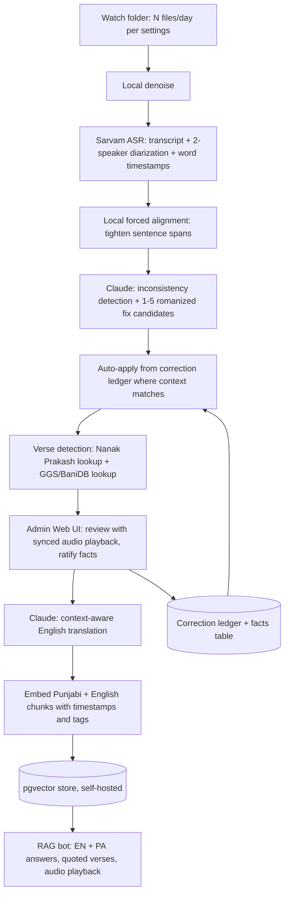

# Nanak Prakash Katha Pipeline: Technical Specification

Version 0.1 (draft for build)
Owner: Jashan
Host: Proxmox server (Zira)

---

## 1. Purpose and scope

Build an automated, mostly hands-off pipeline that ingests audio recordings of Nanak Prakash katha, produces an accurate Punjabi (Gurmukhi) transcript with sentence-level timestamps and speaker roles, applies AI-assisted corrections with a growing correction memory, generates a context-aware English translation, detects and canonically references quoted verses, and serves a retrieval bot that answers in English and Punjabi with the source verses quoted as-is and the original audio playable at the exact offset.

The accuracy goal is not perfection on every spoken word. The goal is a faithful account of the history with correct proper nouns, dates, and facts, verifiable and correctable by an admin through a web UI, with quoted scripture always reproduced from a canonical source rather than from speech recognition.

### Non-goals
- No audio embeddings. Retrieval runs on text (transcript and translation). Audio is linked by timestamp, not embedded.
- No reliance on the speech model to reproduce verse text. Verses are retrieved from canonical databases.
- No real-time or streaming requirement. All processing is batch and throttled.

---

## 2. Source material model

Most clips follow a two-voice structure:

- Speaker A (Reciter): recites verses of Nanak Prakash (Braj in Gurmukhi script).
- Speaker B (Kathakar): explains the meaning of each recited verse in spoken Punjabi.

Occasionally a verse from Sri Guru Granth Sahib (GGS) is quoted inside the discourse. This is rare but must be handled specially: detected, reproduced from canonical GGS text, and referenced with Ang (page) and line.

Implication: two speakers map cleanly onto diarization. Speaker-A segments are tagged as quoted verse (primary text), Speaker-B segments as commentary. The primary book is Nanak Prakash, not GGS.

---

## 3. Canonical text sourcing

### 3.1 Nanak Prakash (primary recited text)
Status: digitized but mostly as scanned, non-searchable PDFs.

Candidate sources to evaluate:
- SearchGurbani "Sri Nanak Prakash" section (evaluate whether verse-structured and scrapable).
- Rara Sahib / Bhai Daya Singh Online Library: Sri Nanak Parkash Vol 1 (Purabaradh) and Vol 2 (Utararadh), PDF.
- Internet Archive full Suraj Prakash PDF (flagged as not searchable when downloaded).
- Bhai Vir Singh 14-volume annotated edition (1927 to 1935) with Punjabi footnotes, as the authoritative steek reference for meaning cross-checks.

Build task (Phase 2, see section 15): produce a clean, verse-indexed Nanak Prakash database. If a structured source exists, scrape and normalize it. Otherwise OCR the Gurmukhi PDFs (Braj-in-Gurmukhi OCR is hard; budget review effort), segment into verses, and store with stable verse IDs. Once this exists, the reciter's track becomes a fuzzy-match lookup instead of a raw speech-recognition gamble, which fixes accuracy on the hardest (sung, archaic) audio and yields exact verse references.

### 3.2 GGS quotes (rare)
Use BaniDB (Khalis Foundation), the most accurate open Gurbani database, self-hosted locally. Fuzzy-match suspected quotation spans; on a confident match, insert canonical Gurmukhi verbatim and attach Ang and line references.

### 3.3 Transliteration tooling
Use the Shabad OS gurmukhi-utils library for conversions between Gurmukhi, ASCII/English (romanized), Devanagari, and Shahmukhi. This backs the admin correction UI, where suggestions are shown in romanized Punjabi for easy reading and typing, then stored canonically in Gurmukhi.

---

## 4. Pipeline architecture

### Stage detail

1. Ingest. A watcher picks up up to N files per day (N is a setting). Files queue in a jobs table.
2. Denoise. Local model on Proxmox (DeepFilterNet or resemble-enhance). Free (compute only). Skippable per-file if Sarvam handles the noise acceptably; make it a toggle and A/B test on a sample.
3. ASR. Sarvam Saaras v3: transcript, 2-speaker diarization, word-level timestamps. Punjabi with native code-mixing, trained on noisy Indian audio.
4. Forced alignment. Local pass (WhisperX or ctc-forced-aligner) to produce tight sentence-level start/end offsets, especially for slow or sung recitation. Store spans per sentence.
5. Inconsistency detection. Claude reviews the transcript, flags low-confidence or implausible spans (garbled proper nouns, broken verse lines, impossible dates), and proposes 1 to 5 candidate fixes plus a custom option, all in romanized Punjabi.
6. Auto-apply. For each flagged span, check the correction ledger. If a fuzzy or phonetic surface match exists and the local context embedding is similar enough to a stored context, auto-apply and log it (reversible). Otherwise leave as a suggestion for the admin.
7. Verse detection. Classify quoted spans. Match Speaker-A spans against the Nanak Prakash DB (Phase 2). Match rare quotation spans against BaniDB for GGS. On confident match, replace with canonical text and attach references; mark as quoted.
8. Admin review. Web UI presents flagged spans with candidate fixes and auto-plays the relevant audio. Admin accepts, edits, or rejects. Admin also ratifies factual assertions (names, dates, relationships). Accepted corrections and facts feed the ledger and facts table.
9. Translation. Once the Punjabi transcript is in good condition, Claude produces a context-aware English translation, preserving quoted verses and their references.
10. Embedding and storage. Chunk and embed both Punjabi and English, carrying timestamps, speaker role, source tags, and verse references. Store in pgvector.
11. Retrieval bot. Answers grounded in verified chunks, in English and Punjabi, quoting verses as-is, with a control to play the exact source audio.

---

## 5. Component selection

| Stage | Choice | Rationale | Marginal cost |
|---|---|---|---|
| Denoise | Local DeepFilterNet / resemble-enhance | Runs on your hardware, free, keeps API cost to ASR only | Compute only |
| ASR + diarization + timestamps | Sarvam Saaras v3 (API) | Best fit for dialectal Punjabi with code-mixing and noisy audio; diarization and word timestamps included. Claude cannot transcribe audio. | ~Rs 30 to 45/hr |
| Forced alignment | WhisperX or ctc-forced-aligner (local) | Tight sentence spans for audio sync | Compute only |
| Inconsistency detection, correction candidates | Claude via Max plan (`claude -p`) | Strong text reasoning; uses your unused Max headroom | ~0 within Max headroom |
| Verse lookup (Nanak Prakash) | Local verse DB (Phase 2) | Turns recitation into a lookup | Free once built |
| Verse lookup (GGS) | BaniDB (self-hosted) | Canonical, accurate Gurbani | Free |
| Transliteration | gurmukhi-utils | Romanized review, canonical storage | Free |
| Translation | Claude via Max plan | Context-aware, religious nuance | ~0 within Max headroom |
| Embeddings | text-embedding-3-small (or self-hosted BGE-M3) | Cheap or free; multilingual | ~0 |
| Vector store | pgvector (self-hosted) | Free on Proxmox | Free |
| Orchestration | Local queue + workers | Full control on your box | Free |

---

## 6. Correction memory (ledger) and auto-apply

The ledger is a domain glossary plus translation memory plus named-entity gazetteer. It is what makes accuracy compound over time.

### Ledger row
- `id`
- `surface_forms`: list of misrecognized spellings seen in ASR output
- `canonical_gurmukhi`: the correct text
- `romanized`: romanized form (for admin display)
- `entity_type`: person | place | date | book | title | term | other
- `english_gloss`: optional
- `context_embedding`: embedding of surrounding words at the point of correction
- `confidence_threshold`: minimum context similarity required to auto-apply
- `times_applied`, `created_by`, `created_at`, `last_used_at`

### Auto-apply logic
Trigger auto-apply only when both hold:
1. Fuzzy or phonetic match between the flagged span and a `surface_forms` entry passes a string-distance threshold.
2. Cosine similarity between the current local context and `context_embedding` is at or above `confidence_threshold`.

If only (1) holds, present as a ranked suggestion in the admin UI. Every auto-application is logged and reversible. As recurring proper nouns accumulate ledger entries, the flag rate falls and admin effort drops.

---

## 7. Verified facts and the admin UI

### Facts table
- `id`, `claim_text`, `entity_type`, `value` (for example a date), `status` (proposed | ratified | rejected), `source_segment_id`, `ratified_by`, `ratified_at`, `notes`.

Claude proposes factual assertions detected in the commentary (for example "states Guru X born in year Y") as `proposed`. The admin ratifies or rejects. The RAG bot answers historical questions from `ratified` facts and from verified transcript chunks, not from the model's own priors, and always cites the source segment.

### Admin web UI (Next.js)
- Job dashboard: queue, status, per-file confidence summary.
- Review view: transcript with flagged spans highlighted; each flag shows 1 to 5 romanized candidates plus custom input; approve, edit, reject.
- Audio sync: selecting a flag auto-plays only that span (uses the stored start and end). A waveform or seek bar aids review.
- Facts panel: proposed facts with ratify or reject and a free-text correction.
- Settings: files per day (throttle), denoise on or off, confidence thresholds, model routing, which folders to watch.
- Ledger browser: search, edit, merge, and retire correction entries.

---

## 8. Timestamps and audio referencing

- Sarvam returns word-level timestamps. Forced alignment tightens sentence and chunk spans.
- Store `start` and `end` per sentence, per chunk, and per flagged span.
- Store audio in the existing homelab media store (same pattern as Plex/servarr). Serve via an HTTP range-request endpoint so both the admin UI and the bot can seek to an offset without downloading the whole file.
- Every embedded chunk carries `audio_file_id`, `start`, `end`. The bot's answers include a play control that seeks to that offset ("hear the actual talk").

---

## 9. Embedding and retrieval

- Embed Punjabi and English separately; keep them linked by `segment_id`.
- Chunk so that a recited verse and its immediately following explanation stay together in one retrievable unit, preserving the verse-and-meaning pairing.
- Metadata per chunk: `speaker_role`, `is_quote`, `verse_ref` (Nanak Prakash verse id or GGS Ang and line), `audio_file_id`, `start`, `end`, `source_clip_id`, `language`.
- Store in pgvector (self-hosted). Optionally add a lexical index for hybrid search on proper nouns.
- Query time: embed the query, retrieve top-k, and have Claude compose a grounded answer in English and Punjabi, quoting verses verbatim from the canonical text and attaching the audio control.

---

## 10. Claude Max plan integration

### Where it is used
The text reasoning stages only: inconsistency detection, correction candidates, verse-detection reasoning, context-aware translation, and RAG answer composition. ASR is never Claude (Claude does not accept audio).

### How
Run Claude Code locally on the Proxmox host in headless mode (`claude -p`) or via the Agent SDK. Running Claude Code locally on your own machine, including as a daemon or cron job, is an intended, official way to use Claude programmatically. As of the June 15, 2026 reversal, programmatic usage (Agent SDK and `claude -p`) still draws from your normal Max subscription limits, so this uses the 40 to 50 percent of Max you currently leave unused.

### Auth
Subscription auth uses browser OAuth and tokens expire in roughly 8 to 12 hours. Extracting or transferring those tokens to run headless elsewhere is prohibited by the Terms of Service. Since this is your own hardware, do the OAuth login on the host itself, or use `claude setup-token` (the intended CI path, historically buggy). Plan for periodic re-auth.

### Fallback and caveats
- Configure `ANTHROPIC_API_KEY` as a fallback. Setting that env var overrides the subscription and bills pay-as-you-go. Use the Batch API (50 percent off) for non-urgent bulk translation.
- Treat subscription-funded automation as a temporary arrangement; Anthropic has signaled it may change with notice. Keep the API fallback wired so a policy change does not break the pipeline.
- Route by difficulty: a cheaper, faster model for routine correction and translation passes, a stronger model only for hard disambiguation. Monitor consumption with `claude /usage`.
- The files-per-day throttle is the primary mechanism that keeps token usage inside your unused Max headroom.

---

## 11. Confidence and flagging

Three independent flags; only flagged segments reach the admin, everything else flows through automatically:
1. ASR confidence below threshold (per segment or word).
2. Verse-match confidence: a span looks like a quotation but no canonical match clears the similarity cutoff.
3. Translation round-trip drift: back-translating the English to Punjabi diverges too far from the source, indicating a shaky translation.

Thresholds are settings, tuned on a labeled sample. Start conservative (more flags), then relax as the ledger matures.

---

## 12. Data model summary

Tables: `jobs`, `clips`, `segments` (with speaker_role, start, end, text_pa, text_en, is_quote, verse_ref, asr_confidence), `chunks` (embedding refs, metadata), `correction_ledger`, `facts`, `verse_nanak_prakash`, `verse_ggs` (or BaniDB proxy), `audio_files`, `settings`, `audit_log`.

---

## 13. Deployment on Proxmox

Suggested service layout (LXC or Docker):
- `ingest-worker`: folder watcher, queue, denoise, forced alignment.
- `asr-client`: Sarvam calls, retry and backoff, cost logging.
- `llm-worker`: local Claude Code runner for correction, verse reasoning, translation; API fallback.
- `verse-db`: BaniDB and the Nanak Prakash verse store.
- `postgres` with pgvector.
- `web-app`: Next.js admin UI and the RAG bot front end.
- `media`: audio store with range-request endpoint (reuse existing media LV pattern).

Reuse existing patterns: shared media volume bind-mounted where needed, GID-mapped permissions, and the existing reverse-proxy and remote-access setup.

---

## 14. Cost model and daily throughput

Assumptions: Sarvam ASR with diarization at about Rs 45 per hour of audio (about USD 0.53). Denoise, forced alignment, verse DBs, embeddings (self-hosted or effectively free), and vector storage all run locally at compute-only cost. LLM reasoning and translation run on the Max plan at roughly zero marginal cost within your unused headroom, with an API fallback modeled separately. Rate used: about Rs 85 per USD.

Recommended baseline throughput: 3 hours of audio per day (a few clips, since katha clips typically run 30 to 90 minutes). This keeps the pipeline comfortably inside Max limits.

| Daily audio | Sarvam ASR | Embeddings + local | LLM via Max | Est. daily cost | Est. monthly (30d) |
|---|---|---|---|---|---|
| 2 hr/day | Rs 90 (~$1.06) | ~Rs 15 | ~0 | ~Rs 105 (~$1.24) | ~Rs 3,150 (~$37) |
| 3 hr/day (baseline) | Rs 135 (~$1.59) | ~Rs 20 | ~0 | ~Rs 155 (~$1.82) | ~Rs 4,650 (~$55) |
| 4 hr/day | Rs 180 (~$2.12) | ~Rs 25 | ~0 | ~Rs 205 (~$2.41) | ~Rs 6,150 (~$72) |

Notes:
- The Max subscription cost is already paid and is not added here; the pipeline consumes previously unused capacity.
- If the LLM steps are run on the API instead of Max (fallback), add roughly USD 0.50 to 2.00 per hour of audio depending on model choice (cheaper models for bulk correction and translation, stronger model only for hard cases). At 3 hr/day that is roughly an extra USD 1.50 to 6.00 per day. Pull exact per-token rates from the current pricing page before committing.
- Corpus build time: at the 3 hr/day baseline, every 100 hours of archive takes about 33 processing days. Scale the throttle up temporarily if you accept spilling LLM work to the API.
- One-time Phase 2 cost: building the Nanak Prakash verse DB (OCR and cleanup, or a scrape) is labor, not recurring API spend.

---

## 15. Phasing

Phase 1 (MVP)
- Ingest, denoise, Sarvam ASR with diarization and timestamps, forced alignment.
- Claude-assisted correction with the ledger and auto-apply.
- Admin review UI with synced audio playback.
- English translation, embedding, pgvector, and a basic RAG bot (EN and PA).
- GGS quote detection via BaniDB (rare-case handling).

Phase 2 (accuracy uplift)
- Build the Nanak Prakash verse database and switch the reciter's track from ASR to canonical lookup with verse references.
- Facts table and admin fact ratification wired into the bot's grounding.
- Hybrid (lexical plus vector) retrieval for proper nouns.

Phase 3 (polish)
- Tighter round-trip translation QA, confidence auto-tuning, ledger merge and cleanup tooling, analytics on flag rates and cost.

---

## 16. Risks and open questions

- Subscription-funded automation may change; keep the API fallback live.
- Nanak Prakash OCR quality for Braj-in-Gurmukhi is uncertain; evaluate SearchGurbani as a structured source first to avoid a heavy OCR effort.
- ASR of dense Braj recitation may stay noisy until the Phase 2 lookup lands; expect a heavier admin review load in Phase 1.
- Headless auth for the Max plan needs an operational routine for periodic re-login.
- Confirm whether Sarvam diarization is bundled at the Rs 30 tier or requires the Rs 45 tier; the cost model assumes Rs 45 to be safe.
